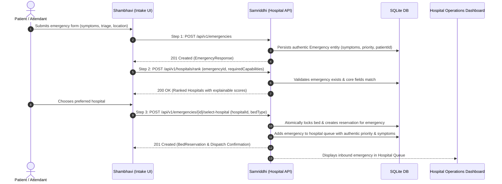

# SirenSync — Cross-Module Integration Contracts & API Guide

**Producer:** Samriddhi (Hospital Intelligence & Bed Management Subsystem)
**Consumers:** Shambhavi (Patient Experience + Intake), Nidhi (Ambulance Coordination)
**Base URL:** `http://localhost:8000/api/v1`
**Swagger UI:** `http://localhost:8000/docs`

---

## Canonical 3-Step Integration Flow

The integration between **Shambhavi's Patient Experience + Intake** subsystem and **Samriddhi's Hospital Intelligence + Bed Management** subsystem follows a strict, 3-step sequence:



---

## 1. Step 1: Emergency Registration & Persistence

Before requesting ranking or reserving a bed, Shambhavi's intake flow MUST register and persist the emergency record. This guarantees that authentic clinical priority (`P1_CRITICAL`, etc.), symptoms, patient ID, and patient coordinates are permanently recorded in the hospital subsystem and cannot be lost or replaced with placeholder values.

* **Method & Path:** `POST /api/v1/emergencies`
* **Trigger:** Patient submits the intake form on Shambhavi's UI.
* **HTTP Status Codes:**
  * `201 Created`: Emergency successfully registered and persisted.
  * `200 OK`: Duplicate submission with identical core attributes (idempotent replay).
  * `409 Conflict`: Duplicate submission where submitted attributes contradict the registered record.
  * `422 Unprocessable Entity`: Schema or validation error (e.g. invalid enum value).

### Request Payload (`EmergencyCreateRequest`)
Supports both `camelCase` and `snake_case` keys:

| Field | Type | Required | Description | Allowed Enums / Format |
|---|---|---|---|---|
| `emergencyId` / `emergency_id` | string | **Yes** | Shared UUID / unique emergency identifier | E.g. `"emg-2026-9821a"` |
| `patientId` / `patient_id` | string | No | Patient account or anonymous profile identifier | E.g. `"pat-shambhavi-101"` (defaults to `pat-{emergencyId}`) |
| `emergencyType` / `emergency_type` | string | **Yes** | Triage category classification | E.g. `"CARDIAC_ARREST"`, `"TRAUMA_CRITICAL"`, `"RESPIRATORY"` |
| `priority` | string (enum) | **Yes** | Clinical triage priority tier | `"P1_CRITICAL"`, `"P2_EMERGENCY"`, `"P3_URGENT"`, `"P4_NON_URGENT"` |
| `patientLocation` / `patient_location` | object | **Yes** | Exact patient pickup GPS coordinates & address | See `CoordinatesContract` below |
| `patientLocation.latitude` | float | **Yes** | Latitude | E.g. `12.9716` |
| `patientLocation.longitude` | float | **Yes** | Longitude | E.g. `77.5946` |
| `patientLocation.address` | string | No | Human-readable address / landmark | E.g. `"MG Road Metro Station, Bangalore"` |
| `requiredBedType` / `required_bed_type` | string (enum) | **Yes** | Clinical bed requirement | `"ICU"`, `"TRAUMA_EMERGENCY"`, `"OXYGEN_HDU"`, `"GENERAL_WARD"`, `"PEDIATRIC_ICU"` |
| `symptoms` | string | No | Free-text / structured patient symptoms | Max 500 chars, e.g. `"Crushing chest pain radiating to left arm"` |

### Example Request (`POST /api/v1/emergencies`)
```json
{
  "emergencyId": "emg-2026-9821a",
  "patientId": "pat-shambhavi-101",
  "emergencyType": "CARDIAC_ARREST",
  "priority": "P1_CRITICAL",
  "patientLocation": {
    "latitude": 12.9716,
    "longitude": 77.5946,
    "address": "MG Road Metro Station, Bangalore"
  },
  "requiredBedType": "ICU",
  "symptoms": "Severe crushing chest pain radiating to left jaw, diaphoresis, shortness of breath"
}
```

### Response (`HTTP 201 Created` / `HTTP 200 OK`)
```json
{
  "emergencyId": "emg-2026-9821a",
  "patientId": "pat-shambhavi-101",
  "emergencyType": "CARDIAC_ARREST",
  "priority": "P1_CRITICAL",
  "patientLocation": {
    "latitude": 12.9716,
    "longitude": 77.5946,
    "address": "MG Road Metro Station, Bangalore"
  },
  "requiredBedType": "ICU",
  "symptoms": "Severe crushing chest pain radiating to left jaw, diaphoresis, shortness of breath",
  "selectedHospitalId": null,
  "createdAt": "2026-10-29T00:30:00Z"
}
```

### Lookup Endpoint
* **Method & Path:** `GET /api/v1/emergencies/{emergency_id}`
* **Returns:** `200 OK` (`EmergencyResponse`) or `404 Not Found`.

---

## 2. Step 2: Hospital Ranking Query

Once registered, Shambhavi's intake screen queries Samriddhi's multi-factor ranking engine to obtain an explainable, deterministic ranking of nearby hospitals.

* **Method & Path:** `POST /api/v1/hospitals/rank`
* **Trigger:** Triggered immediately after registration to display candidate hospitals.
* **Validation Rules:**
  1. `emergencyId` MUST exist in the database (returns `404 Not Found` if unregistered).
  2. Submitted `requiredBedType`, `priority`, and `emergencyType` MUST match the registered record (returns `409 Conflict` if conflicting).

### Request Payload (`RankingRequest`)
```json
{
  "emergencyId": "emg-2026-9821a",
  "patientId": "pat-shambhavi-101",
  "patientLocation": {
    "latitude": 12.9716,
    "longitude": 77.5946,
    "address": "MG Road Metro Station, Bangalore"
  },
  "emergencyType": "CARDIAC_ARREST",
  "priority": "P1_CRITICAL",
  "requiredBedType": "ICU",
  "requiredCapabilities": ["CARDIAC_CATH_LAB", "ICU_VENTILATOR"],
  "symptoms": "Severe crushing chest pain radiating to left jaw"
}
```

### Response (`HTTP 200 OK`)
```json
{
  "emergencyId": "emg-2026-9821a",
  "requiredCapabilities": ["CARDIAC_CATH_LAB", "ICU_VENTILATOR"],
  "rankedHospitals": [
    {
      "hospitalId": "hosp-manipal-hal",
      "name": "Manipal Hospital HAL Airport Road",
      "location": {
        "latitude": 12.9592,
        "longitude": 77.6477,
        "address": "98, HAL Old Airport Rd, Kodihalli, Bengaluru"
      },
      "contactNumber": "+91-80-2502-4444",
      "compositeScore": 0.887,
      "rank": 1,
      "isEligible": true,
      "breakdown": {
        "distanceKm": 5.92,
        "distanceScore": 0.803,
        "capabilityMatchScore": 1.0,
        "matchedCapabilities": ["CARDIAC_CATH_LAB", "ICU_VENTILATOR"],
        "missingCapabilities": [],
        "trafficCongestionFactor": 1.15,
        "trafficScore": 0.87,
        "bedAvailabilityScore": 1.0,
        "availableBedsCount": 5,
        "explanation": "Distance: 5.92 km (score: 0.8). Capability Match: 100% (2/2 matched). Traffic: Moderate arterial traffic (+15% delay) (delay factor: 1.15). Bed Availability: 5 ICU beds available."
      },
      "bedSummary": {
        "ICU": { "available": 5, "reserved": 2, "occupied": 1, "total": 8 }
      }
    }
  ],
  "weightsApplied": {
    "distance": 0.3,
    "capability": 0.35,
    "traffic": 0.2,
    "bedAvailability": 0.15
  },
  "totalHospitalsEvaluated": 5,
  "eligibleHospitalsCount": 4
}
```

---

## 3. Step 3: Hospital Selection & Atomic Bed Reservation

When the patient selects their desired hospital, Shambhavi's UI calls the selection endpoint.

* **Method & Path:** `POST /api/v1/emergencies/{emergency_id}/select-hospital`
* **Trigger:** Patient taps on their chosen hospital card from the ranked list.
* **Validation Rules:**
  1. `emergency_id` MUST be a registered emergency (returns `404 Not Found` if unregistered; no placeholder emergencies are generated).
  2. Submitted `requiredBedType` MUST match the registered emergency's `required_bed_type` (returns `409 Conflict` if mismatched; no changes persisted).
  3. Locks the bed atomically in SQLite using compare-and-swap semantics.
  4. Links the reservation and queue item directly to the authentic emergency record, preserving `P1_CRITICAL` triage priority, symptoms, and patient identity.

### Request Payload (`HospitalSelectionRequest`)
```json
{
  "selectedHospitalId": "hosp-manipal-hal",
  "requiredBedType": "ICU"
}
```

### Response (`HTTP 201 Created`)
```json
{
  "status": "SUCCESS",
  "emergencyId": "emg-2026-9821a",
  "hospitalId": "hosp-manipal-hal",
  "reservation": {
    "reservationId": "res-f4219a10",
    "bedId": "bed-hosp-manipal-hal-icu-01",
    "bedNumber": "ICU-01",
    "bedType": "ICU",
    "status": "RESERVED",
    "reservedAt": "2026-10-29T00:30:15Z"
  },
  "coordinatingHospital": {
    "hospitalId": "hosp-manipal-hal",
    "hospitalName": "Manipal Hospital HAL Airport Road",
    "contactNumber": "+91-80-2502-4444",
    "address": "98, HAL Old Airport Rd, Kodihalli, Bengaluru",
    "dispatchStatus": "AMBULANCE_COORDINATION_INITIATED"
  },
  "message": "Bed reserved securely. Hospital is now the coordinating authority."
}
```

### Conflict Handling (`HTTP 409 Conflict`)
1. **Bed Type Mismatch:** If the requested bed type does not match the emergency's registered requirement:
```json
{
  "detail": "Bed type mismatch: Requested bed type 'GENERAL_WARD' does not match registered emergency required bed type 'ICU'."
}
```

2. **Resource Exhaustion / Race Condition:** If another patient locked the last bed in the same millisecond:
```json
{
  "detail": "Resource conflict: All ICU beds at 'Manipal Hospital HAL Airport Road' were locked by concurrent requests."
}
```

---

## 4. Hospital Operations Dashboard & Queue Visibility

Once Step 3 completes, the inbound patient appears immediately in the Hospital Operations Dashboard queue (`GET /api/v1/hospitals/{hospital_id}/queue` and `GET /api/v1/dashboard/overview`):

```json
[
  {
    "queue_id": "queue-8f12a",
    "emergency_id": "emg-2026-9821a",
    "patient_id": "pat-shambhavi-101",
    "emergency_type": "CARDIAC_ARREST",
    "priority": "P1_CRITICAL",
    "symptoms": "Severe crushing chest pain radiating to left jaw, diaphoresis, shortness of breath",
    "patient_address": "MG Road Metro Station, Bangalore",
    "bed_id": "bed-hosp-manipal-hal-icu-01",
    "bed_number": "ICU-01",
    "bed_type": "ICU",
    "route_progress": 0.0,
    "status": "COORDINATING",
    "created_at": "2026-10-29T00:30:15Z"
  }
]
```

Notice that:
- Clinical priority remains `P1_CRITICAL` (not downgraded to `P2_EMERGENCY`).
- Patient identity (`pat-shambhavi-101`), symptoms, and emergency type are fully preserved.

---

## 5. Integration with Nidhi (Ambulance Coordination & Real-Time Tracking)

### Machine-Readable Rerouting Event
When the Hospital Intelligence subsystem executes a priority reassignment under the **40% route-progress prototype policy**, it generates this exact event structure:

* **Event Type:** `BED_REASSIGNMENT_REROUTE`
* **Event Payload:**
```json
{
  "eventType": "BED_REASSIGNMENT_REROUTE",
  "eventId": "evt-reassign-8f12cb41",
  "emergencyId": "emg-displaced-001",
  "previousHospitalId": "hosp-manipal-hal",
  "previousBedId": "bed-hosp-manipal-hal-icu-01",
  "newHospitalId": "hosp-apollo-bg",
  "newBedId": null,
  "displacingEmergencyId": "emg-displacing-002",
  "displacingPriority": "P1_CRITICAL",
  "displacedPriority": "P3_URGENT",
  "reason": "HIGHER_PRIORITY_EMERGENCY",
  "routeProgress": 25.0,
  "threshold": 40.0,
  "status": "REROUTE_REQUIRED",
  "timestamp": "2026-10-29T00:35:00Z"
}
```

### Action Required by Nidhi's Ambulance Subsystem:
1. Verify `emergencyId` matches active ambulance dispatch.
2. Update destination hospital to `newHospitalId` (`hosp-apollo-bg`).
3. Re-calculate routing path to the new hospital.
4. Notify driver UI and stream live coordinates to patient.

---

## 6. System Execution & Mentor Demonstration Instructions

### Prerequisites
- Python 3.11+ / 3.13 with virtual environment in `backend/venv`
- Node.js 18+ and npm

### Services Architecture

| Service | Port | Directory | Technology | Role |
|---|---|---|---|---|
| **Unified Backend** | `8000` | `backend/` | FastAPI, SQLAlchemy, SQLite | Patient Auth, Intake, 4-Factor Ranking, Atomic CAS Bed Lock, Queue |
| **Patient Frontend** | `5173` | `frontend/patient/` | React, Vite, Lucide | Emergency intake, OTP verification, Hospital choice, Status |
| **Hospital Operations** | `5174` | `frontend/hospital/` | React, Vite | Real-time emergency queue, bed inventory, occupancy overview |

### Commands to Run

#### Terminal 1: Unified FastAPI Backend
```bash
cd /Users/shambhavisingh/Desktop/SirenSync
source backend/venv/bin/activate
export PYTHONPATH="/Users/shambhavisingh/Desktop/SirenSync:/Users/shambhavisingh/Desktop/SirenSync/backend"
uvicorn backend.main:app --host 127.0.0.1 --port 8000 --reload
```
* Interactive API Documentation (Swagger UI): `http://127.0.0.1:8000/docs`
* Static Dashboard Fallback: `http://127.0.0.1:8000/dashboard`

#### Terminal 2: Patient Experience & Intake Frontend
```bash
cd /Users/shambhavisingh/Desktop/SirenSync/frontend/patient
npm run dev -- --port 5173
```
* Patient Web Application: `http://localhost:5173`

#### Terminal 3: Hospital Operations Dashboard
```bash
cd /Users/shambhavisingh/Desktop/SirenSync/frontend/hospital
npm run dev -- --port 5174
```
* Hospital Operations Dashboard: `http://localhost:5174`

---

## 7. Step-by-Step Live Mentor Demonstration Script

1. **Patient Registration & Login (Optional but Recommended):**
   - Open `http://localhost:5173` and click "Sign In / Register Profile".
   - Register an account with your name, phone, blood group, and emergency contact.
   - Upon registration/login, notice the secure green banner: `Signed in as [Name] (Emergency Profile Linked)`.

2. **Trigger Emergency Request:**
   - On the patient landing page, click the prominent red **"REQUEST EMERGENCY AMBULANCE"** button.
   - Tap one of the Bengaluru EMS quick landmark chips (e.g. `MG Road`, `Indiranagar`, `Koramangala`, or `Hebbal`), or use your browser GPS.
   - Select emergency category (e.g., **"Severe Accident / Collision"** or **"Heart Attack / Cardiac"**).
   - Complete human verification and click **"SEND EMERGENCY REQUEST"**.
   - The backend atomically persists the emergency record in `database/sirensync_hospital.db`, assigns an Emergency ID, and returns HTTP 201.

3. **4-Factor Hospital Evaluation:**
   - The UI automatically advances to Step 2: Hospital Evaluation.
   - The backend runs the deterministic 4-factor algorithm:
     - Distance Score (30%)
     - Real-Time Bed Availability (30%)
     - Clinical Capabilities Match (25%)
     - Simulated Corridor Traffic Factor (15%)
   - Hospitals are ranked with explainable match scores (e.g. Manipal Hospital HAL, Apollo Hospital BG Road).

4. **Patient Hospital Selection & Atomic Bed Lock:**
   - Click **"Select Hospital & Reserve Bed"** on your preferred hospital (e.g. Manipal Hospital HAL).
   - The UI enters "Reserving Bed & Coordinating..." state while the backend executes a concurrency-safe CAS (Compare-And-Swap) lock.
   - The bed status transitions from `AVAILABLE` to `RESERVED` and a reservation token is generated.
   - If a hospital has 0 available beds (e.g. Columbia Asia Hebbal with ICU), the backend returns HTTP 409 Conflict and the UI prompts the patient to select another facility.

5. **Hospital Operations Dashboard Live Verification:**
   - Open `http://localhost:5174` (or `http://127.0.0.1:8000/dashboard`).
   - Observe that the inbound patient immediately appears in the emergency queue with authentic triage priority (`P1_CRITICAL`), patient ID, reported symptoms, patient address, and reserved bed number.
   - The bed inventory table reflects the updated reservation count.
